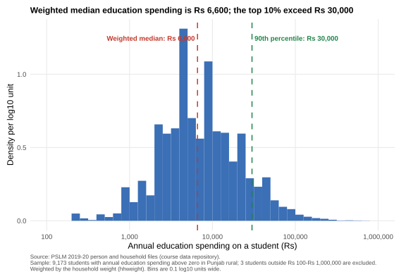
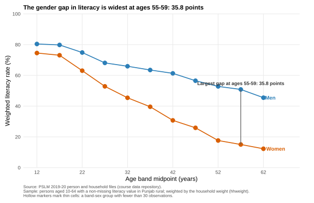

# PRACTICE-ECO346-FA24-BEDS-100

**Independent practice copy - not the submitted assignment.**

Data Visualization Techniques for Economists - Assignment 1 (Fall 2026), worked for
registration number **FA24-BEDS-100** so the concepts can be studied separately from the
real submission for FA24-BEDS-105.

| | |
|---|---|
| **Registration number** | FA24-BEDS-100 |
| **Variant** | **0** = Punjab, rural (prov_code 2, urban_rural 1) |
| **Second language (Question 5)** | Python (pandas + matplotlib) |
| **Data** | PSLM 2019-20 person and household files (subset), in `data/` |

The variant is the last two digits of the registration number, `00`, taken modulo 8:
`00 = 0 x 8 + 0`, so variant 0. Every figure and number below uses only persons and
households in **Punjab rural**. Population estimates (means, quantiles, rates, densities)
are weighted by the household weight `hhweight`, attached from the household file by
`hhid`. Sample counts (n) and the unweighted median are reported unweighted to separate
sample size from population estimates.

---

## How to reproduce everything

Install the packages once on a fresh machine:

```r
# In R console / RStudio:
install.packages(c("ggplot2", "svglite"))
```

```bash
# In terminal / Command Prompt (Python). On Windows, use `py` if `python` is not on PATH:
py -m pip install numpy pandas matplotlib
```

Then, from the project root:

```bash
Rscript scripts/run_all.R
```

Individual scripts can also be run in order:

| Script | Question | Output |
|---|---|---|
| `scripts/01_default.R` | 4 (default) | `figures/default.svg` |
| `scripts/02_distribution.R` | 2 | `figures/distribution.svg` |
| `scripts/03_literacy.R` | 3 (redesign) | `figures/literacy.svg` + `scripts/band_table_R.csv` |
| `scripts/04_literacy.py` | 5 | `figures/literacy_python.svg` + `scripts/band_table_python.csv` (automated test against R) |

Every quantile, including the unweighted median, follows the assignment definition
exactly: sort by the variable, accumulate the weight share, and take the smallest value at
which the cumulative share reaches or exceeds *q*. Equal weights are used for the
unweighted median. R's built-in `quantile()` and `median()` are not used.

---

## Question 2 - The distribution of education spending



**Reported numbers.**

| Quantity | Value |
|---|---|
| Students (ed_total > 0) | 9,173 |
| Students analysed (Rs 100 - Rs 1,000,000) | 9,170 |
| Students excluded (outside the range) | 3 |
| Weighted median | Rs 6,600 |
| Unweighted median | Rs 7,000 |
| Weighted 10th percentile | Rs 2,000 |
| Weighted 90th percentile | Rs 30,000 |
| Ratio of 90th to 10th percentile | 15.00 |
| Mean survey weight below unweighted median | 217.2 |
| Mean survey weight above unweighted median | 208.6 |

**What it shows (<= 80 words).** Education spending is strongly right-skewed: the weighted
population median is Rs 6,600, while the top tenth exceed Rs 30,000, fifteen times the 10th
percentile of Rs 2,000. Weighting pulls the centre down from the unweighted sample median
of Rs 7,000 because students below that median have slightly higher average survey weights
(217.2 vs 208.6), so lower-spending households carry a little more of the rural Punjab
population.

---

## Question 3 - The relationship between literacy and age



**Full band table.** Counts and weighted literacy rates (%) by age band and sex.

| Age band | Men, n | Men, % | Women, n | Women, % |
|---|---|---|---|---|
| 10-14 | 2,209 | 80.4 | 2,133 | 74.5 |
| 15-19 | 1,922 | 79.8 | 1,758 | 73.1 |
| 20-24 | 1,449 | 74.9 | 1,574 | 63.1 |
| 25-29 | 1,201 | 68.1 | 1,386 | 52.9 |
| 30-34 | 1,037 | 65.9 | 1,176 | 45.4 |
| 35-39 | 1,006 | 63.5 | 1,194 | 39.6 |
| 40-44 | 843 | 61.3 | 903 | 30.7 |
| 45-49 | 737 | 56.5 | 776 | 25.9 |
| 50-54 | 708 | 52.8 | 657 | 17.6 |
| 55-59 | 517 | 50.8 | 535 | 15.0 |
| 60-64 | 497 | 45.5 | 412 | 12.3 |

No band-sex cell falls below 30 observations, so no marker is hollow in this variant.

**Reported numbers.**

| Quantity | Value |
|---|---|
| Women aged 15-19 | 73.1 % |
| Men aged 15-19 | 79.8 % |
| Women aged 55-59 | 15.0 % |
| Men aged 55-59 | 50.8 % |
| Band with the largest gap | **55-59** (35.8 points) |

**Interpretation (<= 100 words).** Literacy falls steadily with age for both sexes, and men
outpace women in every band. The gap widens through middle age and is widest at 55-59
(35.8 points: men 50.8%, women 15.0%), reflecting far lower schooling among older women. Women aged 15-19
have a literacy rate of 73.1% versus 15.0% at ages 55-59; men are at 79.8% and 50.8%. The
pattern is consistent with later cohorts receiving more schooling, but a single cross-section
cannot separate cohort effects from ageing or identify causes.

---

## Question 4 - The makeover

The default figure (`figures/default.svg`) is `ggplot(data, aes(age, literate)) +
geom_point()` with R's defaults untouched. The redesign is the Question 3 figure
(`figures/literacy.svg`).

**Explanation of the redesign (<= 150 words).** Three changes, each tied to a principle from
Chapters 1-4. First, the raw scatter is replaced by **conditional means**: the weighted
literacy rate in each five-year band, so the age pattern is no longer buried under thousands
of overlapping 0/1 points (**overplotting**). Second, the redesign keeps **position**, the
highest-ranked channel, for the two continuous quantities - age and the literacy rate - and
uses colour plus direct labels only for the categorical split by sex (**perceptual ranking of
channels**). Third, the legend is dropped in favour of end labels, cutting non-data ink
(**data-ink ratio**). The default figure still shows the actual spread and the discreteness
of the 0/1 outcome, which the redesign hides by plotting one summary value per cell.

---

## Question 5 - A second language (Python)

`scripts/04_literacy.py` recomputes the Question 3 band table, saves it to
`scripts/band_table_python.csv`, and redraws the figure in Python, saved as
`figures/literacy_python.svg`. An automated verification step asserts that the counts and
all eleven age-band weighted literacy rates agree with R within rounding tolerance.

**Reported numbers.** The literacy rate of **women aged 15-19** is **73.1%** from R and
**73.1%** from Python.

**One difference and how it was fixed (<= 80 words).** The default axis range and tick
spacing differed: ggplot expanded the panel around the data, while matplotlib padded the
axes differently, so the two figures would not overlay. I set the same limits in both
scripts (age 9-70, rate 0-100) and the same breaks (age 12, 22, ..., 62; rate 0, 20, ...,
100).

---

## Project structure

```
PRACTICE-ECO346-FA24-BEDS-100/
+-- README.md
+-- data/       pslm_person_subset.csv, pslm_hh_subset.csv
+-- scripts/    01_default.R, 02_distribution.R, 03_literacy.R,
+               04_literacy.py, run_all.R
+-- figures/    default.svg, distribution.svg, literacy.svg, literacy_python.svg
```
